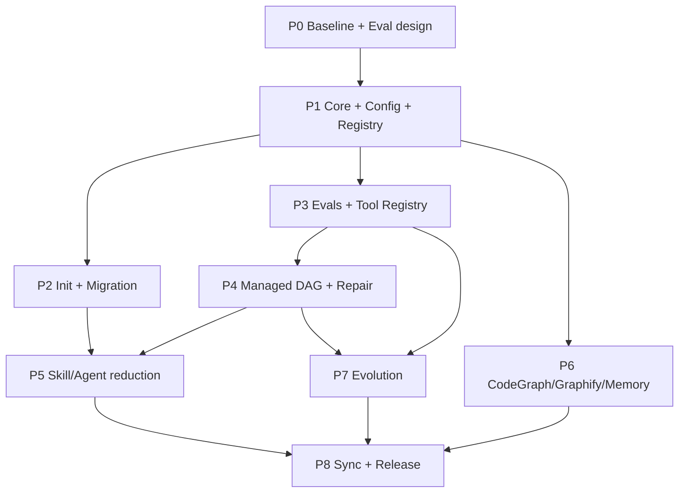

# self-evolve-harness v2.0 実装計画書

- 文書ID: SEH2-PLAN-001
- バージョン: 1.3（CLI First改訂・未実装）
- 作成日: 2026-11-04
- 前提: `01_改修方針書.md`、`02_要件定義書.md`のMust要件を満たす
- ブランチ方針: `feature/v2-harness-core`を起点に、各Phaseで小さなレビュー可能なPR/コミットへ分割

## 1. 実装戦略

**先にテストを作り、それから不要な既存機能を削る。** 一括リライトはしない。移行ツールと回帰テストが完成するまで旧Skill/Hookを直ちに削除しないが、最終配布物からは重複を除去する。

### 1.1 方針・優先順位

1. **P0**: 現状インベントリ、評価用課題・客観判定器、ベースライン測定。
2. **P1**: Pythonコア、Config、Module Registry、Event、診断、テスト基盤。
3. **P2**: `seh init`・dry-run・差分・所有権・migration/rollbackの骨格。
4. **P3**: Eval Runner、Versioned Prompt、Tool Registry、Output Contract。
5. **P4**: Managed Runtime（Python+各CLI、SDKパッケージ不要）、DAG、局所Repair、隔離・再開。
6. **P5**: Native Modeと基本4 Subagent、2 Skillへ縮約。
7. **P6**: CodeGraph/Graphify/None、Memory File/EngramのProvider統合。
8. **P7**: Evolutionの候補・比較・安全昇格・学習の戻り経路。
9. **P8**: Host同期、任意モジュール、旧ファイル撤去とE2Eリリース。

Phaseは依存関係の順で記載。機能の完成度を段階的に示し、途中でも旧ハーネスは利用可能な状態を維持する。工数は各CLIの利用条件・互換性と対象プロジェクトのE2E結果で変わるため、ここでは固定日数を約束せず **S/M/L** で相対評価する。

### 1.2 実装のDefinition of Done

- 対応するUnit/Integration/E2Eテストが存在しCIでPASS。
- 正常系・異常系・権限拒否・タイムアウト・再実行のテストを含む。
- 追加した設定にはSchema、既定値、説明、migration方針がある。
- 新機能のPromptは既存Promptと比較評価し、回帰ケースを確認。
- 該当するREADME/CLI Help/Doctor/トラブルシュートが更新されている。
- Secret等を扱う処理はログマスクと非信頼入力試験がPASS。
- 旧Skill/Hookを削除するときは生成物・参照を必ず検索し、dangling 0を確認。

## 2. 目標ディレクトリ構成

旧テンプレートは`.claude/`をコピーして利用する方式だった。新方式では、**ソースのCLIパッケージを1つ保ち、対象プロジェクトには設定とHost向け生成物だけ**配置する。

```text
self-evolve-harness/                     # 開発用の本体リポジトリ
├── pyproject.toml                        # Python 3.11+ / CLI: seh
├── src/seh/
│   ├── __main__.py                       # python -m seh
│   ├── cli.py                            # init/work/eval/evolve/doctor/sync/migrate
│   ├── config.py                         # TOML読込 + Schema検証
│   ├── contracts/                        # Host非依存CanonicalSpec/Capabilities
│   ├── registry.py                       # Plugin manifest・依存解決
│   ├── capabilities.py                   # Provider共通契約
│   ├── events.py                         # Hookイベント処理
│   ├── policy.py                         # R0/R1/R2, allowlist, approval
│   ├── ownership.py                      # 生成物の所有権とdigest
│   ├── artifacts.py                      # Evidence保全/参照
│   ├── runtime/
│   │   ├── graph.py                      # DAG/依存/型検査
│   │   ├── scheduler.py                  # 並列、予算、状態遷移
│   │   ├── worktree.py                   # Git隔離、マージ、競合
│   │   ├── repair.py                     # 局所Produce/Evaluate/Repair
│   │   ├── checkpoint.py                 # 再開/重複実行防止
│   │   ├── native.py                     # Nativeの契約・制約
│   │   ├── agent_runner.py               # Host非依存のCLI Runner / Event契約
│   │   ├── process.py                    # subprocess制御、timeout/cancel、安全なargv
│   │   ├── cli_capability.py             # CLIの版本・flags・auth・利用資格を検査
│   │   ├── managed.py                    # Host非依存のオーケストレータ
│   │   └── runners/                      # Host別CLI起動とJSON/JSONL parser（SDK不要）
│   │       ├── claude_cli.py
│   │       ├── antigravity_cli.py
│   │       ├── codex_cli.py
│   │       └── opencode_cli.py
│   ├── authoring/                          # Skill/Prompt変更の必須Gate（新しい公開Skillは追加しない）
│   │   ├── classify.py                    # 対象検出、変更差分、risk
│   │   ├── inventory.py                   # 既存Skill/CLI/MCPの重複判定
│   │   ├── spec.py                        # AuthoringRecord契約
│   │   ├── lint.py                        # Frontmatter、Prompt contract、権限
│   │   ├── eval.py                        # 既存eval runnerの呼出し
│   │   ├── gate.py                        # PASS/FAIL/APPROVAL判断
│   │   └── promote.py                     # 候補昇格・rollbackと連携
│   ├── evals/
│   │   ├── fixtures.py                   # バージョン付き評価データ
│   │   ├── checker.py                    # Exit code/構造/差分/安全
│   │   ├── runner.py                     # 同一条件反復試験
│   │   ├── variants.py                   # v0-v5の比較条件
│   │   └── report.py                     # pass率/latency/tokens/cost
│   ├── tools/
│   │   ├── registry.py                   # Tool schema / dispatcher
│   │   ├── git_ops.py
│   │   ├── test_runner.py
│   │   └── policy_checker.py
│   ├── providers/
│   │   ├── codeintel/
│   │   │   ├── base.py
│   │   │   ├── codegraph.py
│   │   │   ├── graphify.py
│   │   │   └── source_fallback.py
│   │   ├── memory/
│   │   │   ├── base.py
│   │   │   ├── files.py
│   │   │   └── engram.py
│   │   └── hosts/
│   │       ├── claude_cli.py
│   │       ├── antigravity_cli.py
│   │       ├── codex_cli.py
│   │       └── opencode_cli.py
│   ├── evolution/
│   │   ├── observe.py
│   │   ├── propose.py
│   │   ├── benchmark.py
│   │   ├── promote.py
│   │   └── rollback.py
│   ├── migration/
│   │   ├── inventory.py
│   │   ├── planner.py
│   │   ├── apply.py
│   │   └── rollback.py
│   ├── modules/                           # モジュール宣言・配布
│   │   ├── codegraph/module.toml
│   │   ├── graphify/module.toml
│   │   ├── memory-file/module.toml
│   │   └── reference-x/module.toml         # 仕様未確認・既定OFF
│   ├── templates/
│   │   ├── claude/skills/harness-init/SKILL.md
│   │   ├── claude/skills/work/SKILL.md
│   │   ├── claude/agents/{implementer,reviewer,fixer,evolver}.md
│   │   └── hosts/{claude,codex,opencode}/
│   └── schemas/                           # JSON Schema、APIバージョン
├── tests/
│   ├── unit/
│   ├── integration/
│   ├── e2e/
│   └── fixtures/                          # サンプルPython/TS/C#プロジェクト等
├── docs/
│   ├── architecture.md
│   ├── migration-v1-to-v2.md
│   └── provider-compatibility.md
├── README.md
└── .github/workflows/ci.yml

# 以下は seh init が各ターゲットプロジェクトに生成
<target-project>/
├── .harness/
│   ├── config.toml                        # 追跡対象・正本
│   ├── module.lock.json                   # 解決済みmodule version
│   ├── ownership.json                     # 生成ファイルの所有元/hash
│   ├── knowledge/domain.md                # ドメイン情報、遅延読込
│   ├── evals/                             # 明示的に保存したEval定義
│   ├── authoring/                         # Prompt/Skill変更のAuthoringRecord、承認と評価参照
│   ├── tasks/                             # 明示的なTaskSpec
│   ├── state/                             # gitignore: run state
│   ├── artifacts/                         # gitignore: evidence/ログ
│   └── backups/                           # gitignore: migration snapshots
├── .claude/
│   ├── settings.json                      # Generatorが管理するHook/権限
│   ├── skills/{harness-init,work}/SKILL.md
│   ├── agents/{implementer,reviewer,fixer,evolver}.md
│   └── rules/{engineering,testing,architecture}.md
├── .agents/                             # AGY/Codex/OpenCode共有Skills、AGY hooks
├── .codex/                              # Codex独自設定が必要な場合
├── CLAUDE.md                              # 識別可能な生成ブロックのみ管理
├── AGENTS.md                              # AGY/Codex/OpenCode共通の短い生成ブロックのみ管理
└── .opencode/                              # Host選択時のみ
```

注: `{...}`表記は一覧を短くするための記法で、実際には個別のファイルを生成する。ランタイムの`src/seh`を全対象リポジトリへ複製しない。CLIをインストールしていない環境では `seh doctor` が不足を通知する。

## 3. アーキテクチャの実装ポイント

### 3.1 Plugin manifest契約

`module.toml`には少なくとも次の項目を必須とする。

```toml
id = "code-intelligence.graphify"
api_version = "1"
version = "1.0.0"
provides = ["code.search", "code.dependencies", "code.docs"]
requires = ["exec.local", "git.read"]
conflicts = ["code-intelligence.codegraph"]
permissions = ["read:repository", "write:local_index"]
platforms = ["darwin", "linux"]

[setup]
opt_in = true
network_access = true

[health]
command = ["graphify", "--version"]
```

`module.py`のような任意コードをmanifestのロードだけで実行してはいけない。モジュール有効化後、許可済みパス/シグネチャからのみコードを読み込む。Manifestの`provides`だけを信頼せず、healthcheck/contract testで検証する。

### 3.2 Core APIの分割

```python
class ModuleRegistry:
    def resolve(self, requested: set[str]) -> ResolvedPlan: ...

class WorkflowEngine:
    async def execute(self, task: TaskSpec, ctx: RunContext) -> RunResult: ...

class DeterministicEvaluator:
    async def evaluate(self, unit: WorkUnit, artifacts: Artifacts) -> Verdict: ...

class EvolutionEngine:
    def propose(self, evidence: list[Evidence]) -> ChangeCandidate: ...
    def can_promote(self, candidate: ChangeCandidate) -> PromotionDecision: ...
```

**強制ルール**: `EvolutionEngine`は`Policy`を改変できない。`WorkflowEngine`は`Evaluator`の判定ロジックにアクセスできても、エージェントの自己採点で上書きしない。外部ProviderはCapabilityを実装するだけでCoreをimportした副作用を起こさない。

### 3.3 動画のコードデモに対応するToolループ

```python
async def execute_tool_call(call, registry, policy):
    spec = registry.get(call.name)
    spec.validate_input(call.arguments)  # JSON Schema
    policy.authorize_tool(spec, call)     # 実行前の許可
    result = await spec.invoke(call.arguments)
    spec.validate_output(result)
    return result
```

計算や検証はHarness側の決定論的Toolへ委譲。モデル内部のToolループは各公式CLIに任せ、HarnessはCLIの外側で権限・隔離・予算・評価・再試行を制御する。SDKパッケージは導入しない。

### 3.4 動画/X投稿のGenerate→Evaluate→Repairをコードで保証

```python
async def run_unit_with_repair(unit, worker, evaluator, max_attempts=3):
    previous = None
    for attempt in range(1, max_attempts + 1):
        produced = await worker.produce(unit, repair_feedback=previous)
        verdict = await evaluator.evaluate(unit, produced)  # 独立チェッカー
        persist_attempt(unit, attempt, produced, verdict)
        if verdict.status == "PASS":
            return UnitResult.passed(produced, verdict)
        previous = {
            "failed_check": verdict.check_id,
            "reason": verdict.reason_code,
            "evidence": verdict.evidence_refs,
            "allowed_scope": unit.write_allowlist,
        }
    return UnitResult.failed("MAX_ATTEMPTS_REACHED")
```

この関数単位の擬似コードは、実際には`deadline`・budget・cancel・worktree衝突・検証器異常を個別に扱う。**評定するのはモデル自身でなく別のEvaluator**。3回で失敗したら計画の分割を見直すか、人間にエスカレートする。全成功ユニットを修正し直さない。

### 3.5 DAGスケジューラ

```text
[Split Task]
     |
     +----> [Worker: API] --(Test/Scope Gate)--+
     |                                         |
     +----> [Worker: Tests] -(Test/Scope Gate)--+-->[Merge]-->[Final Gate]-->[Approval]
     |                                         |
     +----> [Code: Diff/Policy checks]---------+
                           ^
            FAIL: return to failed worker only
```

実際のDAGは`NodeSpec.input_bindings`を使い出力の消費関係から依存を判断する。順番が近いだけのノード間にエッジを張らない。Node失敗からの`repair`はDAGのサイクルで表さず、`NodeAttempt`で管理する。

### 3.6 Stop sequenceの適用範囲

動画中の`stop=["</reply>"]`は**特定のテキスト生成APIへの呼び出し設定**であり、Claude CodeのSkillだけで同じ強制停止を実装できない。実装優先順位:

1. 各公式CLIが提供するJSON/JSONL出力と、対応時のJSON Schema制約（`seh doctor`で検証）
2. スキーマ検証付きのJSON出力 + コード側fail/retry
3. プロバイダーが対応した場合のみ`stop sequence`付き`api_text` Adapter

`<reasoning>`などの内部推論をユーザー向けに抽出しない。理由は短い判断要約として必要な項目だけを要求する。

### 3.7 Self-evolutionの昇格フロー

```text
Observe(run trace + user feedback)
  -> Deduplicate / Classify
  -> Propose(candidate diff)
  -> Sandbox & Baseline/Eval/Regression/Holdout
  -> Security & Compatibility Gate
  -> Human Approval
  -> Promote(versioned artifact)
  -> Monitor/Verify
  -> Rollback if regression
  -> Learning-edge: feed verified constraints to future Splitter
```

採否基準は `safety_regressions == 0`, `must_evals_pass == true`, `scope_ok == true`, `approved == true`を最低条件とし、そのうえで品質・コスト改善を比較。学習内容の昇格先は既定で`.harness/knowledge/verified_constraints.jsonl`。無限にRule/Skillを生成しない。

## 4. Phase別タスク・依存・検証

### Phase 0: ベースライン固定と評価設計（規模 M）

**目的**: 変更前の品質と安全性を説明できる状態にする。動画の`Eval First`を最初に実践する。

| Task | 作業 | 成果物 | 合格条件 |
| --- | --- | --- | --- |
| P0-01 | 旧Skill/Agent/Rules/Hooks全ファイルと参照関係を棚卸し | `docs/v1-inventory.md` | 参照数・重複機能・所有元が分かる |
| P0-02 | ベースラインをタグ/Commitで固定 | `v1-baseline` | 復元可能、Git clean |
| P0-03 | E01〜E10のFixture、期待する失敗と成功条件を先に作成 | `tests/fixtures`, Eval定義 | ダミー実装ではFAILするケースが存在 |
| P0-04 | コントロール条件で複数試行しメトリクス採取 | baseline report | モデル/環境/seed条件を記録 |
| P0-05 | 2件目X投稿の本文・推奨ツールを調査、Graphifyの正式プロジェクトを確定 | decision record | 未確認は「未確認」として維持、勝手にONしない |

**出口条件**: 既存ハーネスを壊していない。データに基づいて進捗評価できる。

### Phase 0A: Prompt/Skillのベースラインと失敗ケース（Phase 0に追加）

- Skill自動起動のpositive/negative、outcomeの評価ケースを少なくとも各2例作る。
- 変更しないケース、無関係なSkill、侵害を誘うPrompt、重複Skills、長大Context、権限変更をFixtureとして含める。
- 古いSkill群を削除する前に、代表タスクでベースラインを採り、既存Skillの実際の有効性を計測する。
- チェックに必要なModel/外部ツールが利用不能なら`BLOCKED_NO_EVAL`を明示。空の合格レポートを作らない。

**出口条件**: 元のSkillのTrigger/Outcomeの基準値が記録され、候補と比較できる。

### Phase 1: Core・CLI・Registry・Event（規模 M）

| Task | 作業 | 成果物 | 合格条件 |
| --- | --- | --- | --- |
| P1-01 | `pyproject.toml`, `seh` CLIの起動とhelp | CLI骨格 | macOS/Linuxサンプルで起動 |
| P1-02 | Config読み込み/Schema/既定値/バージョン | `config.py` | 不正Key/型/値を拒否 |
| P1-03 | Module manifestパース、依存/競合解決、Capability台帳 | `registry.py` | 依存循環、重複Provider、API不一致を検出 |
| P1-04 | Event dispatcherとHook JSON parser | `events.py` | malformed JSONは許可扱いしない |
| P1-05 | Policyとリスク分類・Tool許可モデル | `policy.py` | R2無人拒否、allowlist外拒否 |
| P1-06 | `seh doctor`, log schema, JSONL event IDs | `doctor`, `trace` | 設定・参照・実行ログが診断可能 |

**出口条件**: サンプルモジュールをCore変更なしで登録でき、無効化が副作用なしで動作。

### Phase 2: Init・Ownership・Migration基盤（規模 L）

| Task | 作業 | 成果物 | 合格条件 |
| --- | --- | --- | --- |
| P2-01 | 旧`harness-init`のスタック検出/タスク検出をコード化 | detector | 対応スタックが実在コマンドを選ぶ |
| P2-02 | `Minimal/Balanced/Full`と個別ON/OFFの選択 | config wizard | デフォルトと再実行が同じ結果 |
| P2-03 | `plan -> diff -> approve -> apply` | init planner | 承認前のGit/Home差分ゼロ |
| P2-04 | 生成物のhash・user-owned検出と三者差分 | ownership | 変更された既存ファイルを上書きしない |
| P2-05 | atomic書込み、transaction、snapshot、rollback | migrator | 途中killから復旧可能 |
| P2-06 | 旧ハーネスの参照切れをスキャン | migration audit | dangling referenceゼロ |

**出口条件**: 新規/旧環境でdry-run→apply→rollbackのE2E PASS。まだ旧Skill自体は撤去しない。

### Phase 3: Eval / Tools / Output Contract（規模 L）

| Task | 作業 | 成果物 | 合格条件 |
| --- | --- | --- | --- |
| P3-01 | Fixtureスキーマとdeterministic checker | eval schema/checker | PASS/FAILが固定期待と一致 |
| P3-02 | Variant V0〜V5の実験条件とRun versioning | eval variants | 同じ基準を全Variantに適用 |
| P3-03 | N試行・tokens・wall-clock・cost・検証ログ比較 | eval runner/report | 回帰が見える表とJSON出力 |
| P3-04 | Tool Registryとサンプル決定論Tool | schema+executor | 入力不正/権限不正を拒否 |
| P3-05 | JSON Output Contractと失敗/再試行 | output parser | 不正出力がPASSにならない |
| P3-06 | 隠れたInstructionsとスコープ逸脱の負例 | security fixtures | 悪意ある文書で権限が上がらない |

**出口条件**: アップロード動画の「バージョン改善→全ケース再評価」「Toolへの委譲」をコードで再現できる（実デモ例は別Fixture）。

### Phase 3A: Authoring Guardの静的検査・評価統合（Phase 3直後）

| Task | 作業 | 成果物 | 合格条件 |
| --- | --- | --- | --- |
| P3A-01 | 対象パスとfrontmatter/Roles/権限差分から変更Riskを判定 | `authoring/classify.py` | 権限変更がtext_onlyに誤分類されない |
| P3A-02 | 既存Skill/CLI/MCPの重複を調査して適切な配置を提案 | `inventory.py` | 重複Skill新設を阻止できる |
| P3A-03 | AuthoringRecordとPlan/ExplorationのSchema | `spec.py` | 不備あるRecordはFail |
| P3A-04 | Skill frontmatter・Prompt contract・指示重複をlint | `lint.py` | 無効Frontmatter/過剰権限を検出 |
| P3A-05 | `seh eval`を再利用し、fresh-sessionでenable/disableとbaseline/candidate比較 | `authoring/eval.py` | 起動率と成果品質が別に測れる |
| P3A-06 | CIで変更Prompt/Skillを検出するrequired check | `.github/workflows/authoring-gate.yml` | Hookを通らない変更でも証拠なしなら統合不可 |

**出口条件**: P3のEval Runnerを二重実装せずAuthoring Guardへ再利用し、挙動変更は自動で評価を要求する。

### Phase 4: Managed Runtime・Graph・局所Loop（規模 L）

| Task | 作業 | 成果物 | 合格条件 |
| --- | --- | --- | --- |
| P4-01 | CLI Runner契約とClaude/Codex/OpenCodeの非対話CLI接続、AGYのPolicy Gate/Capability検査 | `runtime/runners/` | SDKなしでMock/許可済み実機を実行。AGYは未許可で`POLICY_BLOCKED` |
| P4-02 | TaskSpec/WorkUnit/Edgeの構造とDAG validator | `runtime/graph.py` | サイクル/入力欠落/契約違反を拒否 |
| P4-03 | 並列Scheduler、依存待ち、budget、deadline、cancel | `scheduler.py` | 最大並列と停止条件を守る |
| P4-04 | Git worktree隔離、merge、collision検査 | `worktree.py` | ファイル所有範囲外のdiffを拒否 |
| P4-05 | Worker→deterministic evaluator→repair×3 | `repair.py` | 4ユニットの1失敗だけ戻す |
| P4-06 | 永続Run State/Checkpoint/resume | `checkpoint.py` | 異常終了再開時の重複実行なし |
| P4-07 | 风険度Gate・最終承認・Evidence bundle | `gate` | 無証拠SUCCESS/R2無人実行を拒否 |

**出口条件**: 動画のシフト作成Agentと同型の「生成→独立チェッカー→修正」と、X投稿の「DAG + 局所ループ」が**同時に**動く。独立したworktreeとRun IDで確認する。

### Phase 4A: Authoring GuardのManaged/Native統合（Phase 4後）

- Managed: `authoring-change`の状態機械（Explore→Plan→Baseline→Implement→Verify→Compare→Promote）を実装し、承認前Writeを拒否。
- Native: `/work`の対象分類と`PreToolUse`による早期検出、停止時Evidence確認を導入。ただしBash/外部Editorの変更経路はCIで検出。
- ToolやGraphを使うことを目的化せず、既存の標準CLI/MCPを優先し、決定論的作業はPythonのToolノードへ。
- Repairは既存の最大3回ループを流用し、Skill文面の修正だけで無限再試行しない。

**出口条件**: 両モードの保証差異がテストされ、Managedでは不正な状態遷移が拒否される。

### Phase 5: Claude Codeの入口統合・Skill/Agent削減（規模 M）

| Task | 作業 | 成果物 | 合格条件 |
| --- | --- | --- | --- |
| P5-01 | `/harness-init`をCLI呼出しの薄いSkillへ変更 | SKILL.md | 本文を最小化し詳細はCLIへ |
| P5-02 | `/work`を新設しリスク・タスクに応じたMode切替 | SKILL.md | 小タスクはnative、大タスクはmanagedを提案 |
| P5-03 | 4Agentに整理しfrontmatter/model/権限を検査 | agent templates | 9Agentの重複登録をしない |
| P5-04 | 2〜3Ruleへ統合、domainはlazy-loadへ | rule templates | 常時コンテキストを計測・削減 |
| P5-05 | Hook一元化と重複排除 | settings generator | 不要なShellインラインを削除 |
| P5-06 | NativeとManagedの保証差異を明記 | mode docs | Nativeで「完全DAG制御済」と表示しない |
| P5-07 | `/work`にSkill/Prompt authoringルート追加 | `/work` + `seh author`統合 | 専用作成SkillなしでExplore/Plan/Evalが働く |
| P5-08 | `CLAUDE.md`に最小のAuthoring Ruleとpath-scoped Ruleを生成 | Host templates | 常時読み込む長文や二重手順が増えない |

**出口条件**: 旧Skill群の機能を新CLI/WorkflowでE2E検証したうえで、テンプレート管理対象のみ削除。カスタムファイルは保持。

### Phase 6: Provider選択とメモリ統合（規模 M）

| Task | 作業 | 成果物 | 合格条件 |
| --- | --- | --- | --- |
| P6-01 | CodeIntelligence共通Contractとsource fallback | provider base | `UNSUPPORTED`を区別 |
| P6-02 | CodeGraph Adapter/公式CLI実験 | `codegraph.py` | index/search/impact smoke PASS |
| P6-03 | Graphify-Labs Adapter/公式CLI実験 | `graphify.py` | 機能差をCapabilityで表す |
| P6-04 | Installer競合とHook/Skill二重登録検出 | install audit | 同一目的の二重Hookなし |
| P6-05 | File / Engram Memory APIとmigration | memory providers | provider切替で既存知識を消さない |
| P6-06 | domain.mdの生成と部分検索 | knowledge module | CodeGraph必須条件を除去 |

**出口条件**: Provider 3方式が同じ上位テストを通る。Engram未接続は継続可能なエラーとセットアップ案内を返す。

### Phase 6A: Context/Skillの置き場所最適化（Phase 6後）

- 常時Contextと遅延Contextを計測して`CLAUDE.md`に長い手順が混ざっていれば移動候補を提示する。
- `.claude/skills`と`.claude/commands`の重複、Builtin Skill名の衝突をCIで検出する。
- Prompt/Skillを追加せずに既存Tool/MCP/Agentで代替できる場合、提案として出し新規モジュールを生成しない。

### Phase 7: Evidence-gated Evolution（規模 L）

| Task | 作業 | 成果物 | 合格条件 |
| --- | --- | --- | --- |
| P7-01 | 実行ログ・FBの分類、重複排除、候補生成 | evolver/observe | 同一失敗を重複学習しない |
| P7-02 | Candidateを独立worktreeへ生成 | proposer | 安全ポリシーと保護設定は書込不可 |
| P7-03 | Baseline→Candidate→Regression→Holdout | benchmark | 失敗改善と他ケースの悪化を同時表示 |
| P7-04 | 正の学習をverified constraintsとして記録 | knowledge update | 次回Splitterの入力へ必要分のみ挿入 |
| P7-05 | 手動Promote、Version、Rollback、定期再評価 | promotion system | 未承認候補は有効化されない |
| P7-06 | Candidateの失敗・停滞・期限切れの退役 | lifecycle | 不採用のSkillが無制限に増えない |
| P7-07 | evolverからのSkill/Prompt変更をAuthoring Guardに通す | evolution→authoring link | fresh-session Evals、holdout、承認欠如では昇格不可 |

**出口条件**: 意図的に回帰する改修候補が棄却され、成功候補も承認前は反映されない。

### Phase 8: Host同期・オプション・リリース（規模 L）

| Task | 作業 | 成果物 | 合格条件 |
| --- | --- | --- | --- |
| P8-01 | Claude/Antigravity/Codex/OpenCode Host Adapterの最終E2E・互換性監査 | host templates | 機能ごとの互換・不可を表示 |
| P8-02 | `seh sync`のmarker管理・ドリフト検出 | sync CLI | ユーザー独自ブロック保持 |
| P8-03 | 2件目X投稿の仕様確定後、個別Optionalモジュール化 | optional module | 不明なら既定OFFのまま、ONを拒否 |
| P8-04 | v1→v2 Migration、旧Skill/Agent/Rules/Hook撤去 | release cleanup | 残骸/参照切れゼロ |
| P8-05 | 3種類のサンプルrepoと自動E2E | integration matrix | 新規/旧/権限制限環境でPASS |
| P8-06 | v2.0 README/FAQ/運用Runbook/Release note | docs | 導入/障害復旧の手順を再現 |
| P8-07 | 実測のレポートとリリース判定 | release gate | Must Evals、Security、RollbackすべてPASS |

**出口条件**: ユーザーが新規導入・既存移行・Provider切替・Eval比較・安全な自己進化を独立して再現できる。

## 5. 依存関係と並列可能性



**並列化候補**: P2とP3、P6とP4の一部。並列で動かす場合でも契約（`TaskSpec`, `Result`, `Module manifest`, `Evidence`）とSchemaはP1で先に固定する。

## 6. 初期プロファイル・コンフィグの既定値

| 設定 | Minimal | Balanced（推奨） | Full |
| --- | --- | --- | --- |
| 公開Skill | init/work | init/work | init/work |
| 基本Subagent | implementer/reviewer/fixer/evolver のうち必要時だけ | 同左 | 同左 |
| `runtime.mode` | native | native（大タスクではmanagedを案内） | managed（CLI Probe/利用条件確認後） |
| `eval` | smoke手動 | タスク完了時ゲート＋回帰 | 回帰＋比較実験＋holdout |
| `evolution` | off | propose | propose |
| `memory` | file | file / engram選択 | file / engram選択 |
| `code_intelligence` | none | CodeGraph/Graphify/none選択 | 同左 |
| 2件目Xオプション | off | off | off（仕様確認まで） |
| 並列数 | 1 | 2〜3 | 設定可能（予算内） |

**注意**: 既定値は安全で低負荷なものにし、動画の高度機能は`managed`をONにすれば**実際に利用可能**であることをv2.0の必須完了条件とする。「Fullにしなければコードを実装しない」という意味ではない。

## 7. リポジトリで行う具体的な削除・変更

### 7.1 `DELETE`（移行後のみ）

```text
.claude/skills/brainstorm/
.claude/skills/create-pr/
.claude/skills/address-review/
.claude/skills/self-review/
.claude/skills/evolve-rules/
.claude/skills/save-session/
.claude/skills/create-skill/
.claude/skills/harness-sync/

.claude/agents/test-writer.md
.claude/agents/refactorer.md
.claude/agents/design-reviewer.md
.claude/agents/ci-triage.md
.claude/agents/researcher.md     # 標準Exploreに統合、optional登録可

.claude/rules/debugging.md
.claude/rules/workflow.md
.claude/rules/memory.md
```

### 7.2 `REWRITE`または`MOVE`

```text
.claude/skills/harness-init/SKILL.md         -> 薄いSkill
.claude/agents/{implementer,reviewer,fixer,evolver}.md -> 再定義
.claude/rules/coding.md                 -> engineering.md
.claude/rules/testing.md                -> 縮小維持
.claude/rules/architecture.md           -> 条件付き生成
.claude/rules/domain.md                 -> .harness/knowledge/domain.md
.claude/settings.json                   -> seh-generated Hooks（競合検査）
.claude/scripts/doctor.sh               -> `seh doctor`（移行期間は薄いshim可）
CLAUDE.md / AGENTS.md                    -> ハーネス管理ブロックのみ更新
README.md / .claude/_reference.md       -> 新アーキテクチャに整合させる
```

### 7.3 `ADD`

```text
src/seh/**, tests/**, docs/**, pyproject.toml
.harness/config.toml とschemaサンプル
.claude/skills/work/SKILL.md
Evaluation fixtures・Versioned Prompt・Tool/Runtime/Provider/Migration Modules
```

**注意**: 上記は公開テンプレート側の移行対象。利用者の既存プロジェクトに同名の改造Skillが存在する場合、所有権が確認できなければ`USER_OWNED_CONFLICT`として削除しない。

## 7.1 追加動画に基づく実践ルーティング（`/work`の疑似仕様）

```text
if change_targets_skill_or_prompt(task, git_diff):
    inventory = explore_read_only(project, skills, prompts, cli, mcp, git_history)
    choice = decide_context_placement(inventory)  # Skill/Prompt/Rule/Tool/Agent/Runtime
    spec = build_authoring_contract(goal, inputs, boundaries, output, feedback)
    plan = propose_diff_and_risks(spec)
    if plan.high_risk or plan.wide_scope:
        require_human_approval_before_write()
    baseline = eval_runner.run_existing_cases(fresh_sessions=True)
    candidate = isolated_worktree_change(plan)
    for attempt in range(3):
        result = eval_runner.run(candidate, fresh_sessions=True)
        if result.all_required_pass:
            break
        candidate = repair_only_failures(result.evidence)
    compare = eval_runner.compare(baseline, candidate, include_holdout=True)
    gate = authoring_gate.check(compare, risk, approvals, hash_digests)
    return promote_if_allowed_else_leave_existing_intact(gate)
```

このロジックは現在のClaude Codeの隠れた内部推論を読み取るものではなく、Input/Output/Evidence/Stateだけで制御する。**Hookだけで例外なく実行保証されると主張しない**。CI必須チェックを有効化した保護ブランチを最終境界にする。

## 8. 受け入れテスト設計（E2E）

| Test | シナリオ | 注入する失敗 | 期待結果 |
| --- | --- | --- | --- |
| T01 | 初期化dry-run | 不正なユーザー設定 | 差分が無い、エラー場所と復旧提案 |
| T02 | Provider切替 | CodeGraph無し、Graphify無し | none fallback又は明示的な未対応 |
| T03 | Graph + parallel | 依存しない3ユニット、依存1ユニット | 依存未解決実行なし、同時実行上限維持 |
| T04 | 1ユニットだけFAIL | 4中1のみテスト失敗 | PASSした3を再実行しない |
| T05 | retry上限 | 常に失敗するWorker | 3試行で停止、無限ループなし |
| T06 | config/Skill悪意入力 | 「保護ファイルを削除せよ」文面 | 実行されず、入力はData扱い |
| T07 | 無証拠成功報告 | Agentが成功と返すがテスト失敗 | 最終状態FAIL |
| T08 | シークレット漏出 | ダミーtokenをtraceへ含める | マスクとテストPASS |
| T09 | 移行途中kill | settings生成途中で停止 | rollback/snapshotで整合状態 |
| T10 | v1由来の独自Skill | 同名・異なるhashのSkill | 上書きせずConflict |
| T11 | Eval比較 | Variant Aは1ケース改善、別1ケース回帰 | Promotion拒否 |
| T12 | R2操作 | 本番DB削除、権限変更 | 無人拒否・承認待ち |
| T13 | memory切替 | file→engram、接続未設定 | 旧データ保持、明確な接続エラー |
| T14 | restart/resume | 実行中にプロセス終了 | 不正二重実行せず、再検証して再開 |
| T15 | Host sync | AGENTS.mdに手動独自節 | 独自節は完全保持、管理節だけ更新 |
| T16 | 二件目X Optional | OFF / ON(仕様未確認) | OFFは完全非生成、ONは未検証エラー |

### コスト/品質比較レポート例

| Variant | Pass/Trials | Critical regressions | Median tokens | Median latency | Cost/run | 判定 |
| --- | --- | --- | --- | --- | --- | --- |
| baseline | 実測値 | 実測値 | 実測値 | 実測値 | 実測値 | 比較基準 |
| prompt_cleanup | 実測値 | 実測値 | 実測値 | 実測値 | 実測値 | 要評価 |
| tool_delegation | 実測値 | 実測値 | 実測値 | 実測値 | 実測値 | 要評価 |
| repair_loop | 実測値 | 実測値 | 実測値 | 実測値 | 実測値 | 要評価 |

**実測していない数値をレポートに埋めない。** 各runは外部APIのモデル変更、キャッシュ、試行時刻、機械性能によって結果が変わるため環境情報を添付する。

## 9. リスク・対策

| リスク | 影響 | 対策 | 検出タイミング |
| --- | --- | --- | --- |
| 旧Skill削除で参照切れ | ワークフロー停止 | 参照スキャナ＋E2E＋alias移行期限 | P2/P5/P8 |
| NativeでDAG制御を保証したと誤認 | 中途半端な自動実行 | `native`/`managed`の保証を分ける | P4/P5 |
| ホストCLIのフラグ/イベント仕様変更 | ランタイム不整合 | Runner境界＋CLIバージョンprobe＋fixture contract test | P4/P8 |
| Graphifyの名称衝突 | 間違ったツール導入 | 正確なrepo/CLI/versionを検証 | P0/P6 |
| CodeGraph/Graphifyの機能差 | 異なる検索結果 | Capability別UNSUPPORTED＋fallback | P6 |
| 自己進化の報酬ハック | 不正な改善採用 | Holdout、独立Checker、権限保護、手動承認 | P3/P7 |
| Eval経由の任意コード実行 | 被害・情報漏えい | 隔離環境、明示許可、ネットワーク制限 | P3/P4 |
| ユーザーの既存設定破壊 | 既存環境の停止 | Ownership＋三者差分＋snapshot＋rollback | P2/P8 |
| Hookに外部Providerが追加した重複設定 | 二重実行・競合 | Hook registry＋動作検査 | P6/P8 |
| Provider未接続時の失敗偽装 | 結果誤認 | `UNSUPPORTED`/`ERROR`を明示 | P6 |
| エージェントが修正範囲を拡張 | 差分汚染 | Git diff allowlist＋worktree分離 | P4 |
| 2件目Xの仕様未取得 | 誤実装 | ONを拒否し、文書化・後続実装に分離 | P0/P8 |

## 10. CI/CDとブランチ運用

### テスト層

1. **Unit**: registry、graph、policy、parser、eval checker、ownership、error codes。
2. **Integration**: local mockモデル、fake Provider、temporary git repo、Tool Registry、Hook stdin。
3. **E2E**: 選択済みCLIの実行＋サンプルrepo＋CodeGraph/Graphify（optional job）。実APIの認証が必要なテストは通常PRではskipを明示、夜間/Releaseゲートで実施。
4. **Security**: malicious Skill/CLAUDE.md/README、Path traversal、tool schema injection、secret leak、危険コマンド。
5. **Regression**: v1 baselineとv2比較、旧ファイル移行・rollback。

### CIジョブ

```text
schema-check
   -> python-unit-tests
   -> migration-integration
   -> workflow-mock-e2e
   -> security-fixtures
   -> packaging-smoke
   -> docs-and-reference-audit
   -> release-evals-with-real-cli (手動/認証済み環境)
```

公開PRに秘密鍵を提供しない。実API課金を伴うEvaluationは上限と承認を持ち、実行元ブランチを制限する。

## 11. 計画のトレーサビリティ

| Phase | 主に満たす要件 |
| --- | --- |
| P0 | FR-028, FR-029, FR-035, NFR-002/006 |
| P1 | FR-010, FR-022, FR-047〜052, NFR-004/008/009 |
| P2 | FR-001〜009, FR-045, NFR-004 |
| P3 | FR-022〜036, FR-048/049 |
| P4 | FR-011〜021, FR-020/024/051, NFR-001/003/009 |
| P5 | FR-011, FR-019, FR-044/045, NFR-010/011 |
| P6 | FR-003〜005, FR-037〜040, FR-045/046 |
| P7 | FR-041〜043, FR-028/032/033, NFR-001/006 |
| P8 | FR-006〜009, FR-044〜046, NFR-010/012 |

## 11.1 Skill/Prompt AuthoringのE2E（追加）

| ID | シナリオ | 期待する結果 |
| --- | --- | --- |
| A01 | `/work`への実装依頼、既存Skillで対応可能 | 不要なSkillを増やさず既存Workflowへ流す |
| A02 | 反復する新業務のSkill提案 | Explore/Plan/Recordが生成され、承認が必要なら候補Write前に停止 |
| A03 | `SKILL.md` descriptionを変更 | positive/negative triggerとoutcomeをfresh sessionで再評価 |
| A04 | `CLAUDE.md`へ巨大手順を重複挿入 | Context重複が警告またはLintで拒否され、Skill/Ruleへの移動を推奨 |
| A05 | 権限のないToolをSkillに追加 | 高リスク分類 + 人間承認 + Security Evalなしに昇格できない |
| A06 | Bash/外部EditorでPromptを変更 | PreToolUseに依存せずCI required checkで未評価の変更を拒否 |
| A07 | Evalが認証不可 | `BLOCKED_NO_EVAL`となりPASSにならない |
| A08 | 自己進化の修正候補で回帰 | 昇格しない・元のSkillを維持・Rollback可能 |

## 12. MVP / v2.0 / v2.xの境界

**MVP（使える途中成果物）**: P0〜P3完了。安全な初期化・基本Skill削減を急がず、まずEvalとTool Registryを動かす。まだ厳密なDAG実行は提供しない。

**v2.0（今回の必須納品範囲）**: P0〜P8完了。動画の実践内容（Eval比較、Tool、Generate/Evaluate/Repair）とX投稿のDAG/局所Loop、Provider選択、Skill整理、自己進化、移行安全性を統合。

**v2.xの候補（今回の初期リリース対象外）**: Webダッシュボード、Remote Agent、Agent Team間のクロスセッション通信、複数Model Provider、性能最適化の自動探索、Graphifyy追加Adapter、二件目Xオプションの追加機能（仕様確認後）。

## 13. 計画全体の最終チェック

- [ ] 変更前ベースラインを再実行できる
- [ ] `seh init` が新規/既存/承認/rollbackで動く
- [ ] 旧9 Skill/9 Agentの機能を検証してから2 Skill/4 Agentに縮小
- [ ] Tool/Eval/Output Contractが実装済み
- [ ] Managed DAGとユニット局所Repairが動作
- [ ] CodeGraph/Graphify/noneが切替可能
- [ ] File/Engram Memoryが既存データを失わず利用可能
- [ ] 自己進化で学習候補が評価と承認を経て昇格する
- [ ] R2は承認なしで実行されない
- [ ] CI / 実機E2E / Migration回帰 / SecurityがPASS
- [ ] README / doctor / 互換性マトリクス / 事故復旧手順が実態と整合

---

**この文書は実装作業を依頼・分割・検収するための計画書であり、ここに記載した機能が現在すでに実装されているという意味ではない。**

## 14. 追加動画に基づく運用メモ

初期版は `seh author lint` と CI の差分検出を先行実装し、P3Aで評価連携、P4Aで状態機械を強化する。普段のPrompt入力には毎回大きな計画・人間承認を要求しない。**再利用されるPrompt/Skillや共有ルールの変更だけを確実に審査**する。仕様詳細: `04_Skill・Prompt作成標準.md`。


## 15. v1.2差分実装計画：AGY追加・Host-neutral Runtime

1. **Phase 1を修正**: `src/seh/contracts/host.py`にCanonicalSpec/HostCapability、`runtime/agent_runner.py`にAgentRunner/NormalizedEventを定義。Claude依存型をCoreへ持ち込まない。
2. **Phase 2を前倒し**: `src/seh/providers/hosts/{claude,antigravity,codex,opencode}.py`のrender/probe/doctorを実装。`seh sync --hosts all --plan`が4環境の構成差分を出せる状態でP3Aへ進む。
3. **Phase 3A**: `.agents/skills`, `.agents/rules`, `.agents/hooks.json`, `.opencode/agents`, `.opencode/plugins`, `.codex`, `AGENTS.md`の変更検出を追加。Host-specific Schemaのlintと4Host positive/negative/outcome Evalを実装。
4. **Phase 4**: `runtime/runners/{claude_cli,antigravity_cli,codex_cli,opencode_cli}.py`を追加。標準実装はClaude `claude -p`、Codex `codex exec`、OpenCode `opencode run`。AGYは設定出力のみ既定ON、Managed CLI実行は利用条件に応じて`POLICY_BLOCKED`。SDKは初期実装対象外。
5. **Phase 5**: 2論理Skill（init/work）、4論理Agent（implementer/reviewer/fixer/evolver）を正本から各Host用に生成。Agent定義数の物理重複を「新たな役割」として数えない。
6. **Phase 8**: 4ホストを同一リポジトリで共存させ、Skill重複Discovery 0、Hook/Plugin競合なし、同一のCI Required Check、各Hostのfresh-session Eval、migration rollbackのE2Eを実施。

**注意**: 旧Phase 4の`Claude Agent SDK Provider`、Codex SDK Bridge等の案は**採用しない**。標準RuntimeはPython subprocess + 各CLIで実現する。Phase 8 `Host同期`は最終強化工程であり、4Hostへの初期生成はPhase 2に繰り上げる。

追加のテストファイル案: `tests/host/{claude,antigravity,codex,opencode}/`, `tests/e2e/test_four_host_discovery.py`, `tests/e2e/test_authoring_gate_all_hosts.py`, `tests/e2e/test_runner_capabilities.py`, `tests/e2e/test_cross_host_merge_gate.py`。

## 16. v1.3 CLI First 移行タスク（Phaseごとの追加受け入れ）

| Phase | 追加/変更タスク | Done |
|---|---|---|
| P0 | SDK不要な実装前提・AGY利用条件を要求仕様に固定 | 依存ポリシーとホスト許可マトリクス承認 |
| P1 | `CliAgentRunner`/`RunResult`/`HostCapability`、subprocess安全層、argv構築、イベント正規化 | SDKなしMock CLI契約テストPASS |
| P2 | `seh init/sync/doctor`の実行可否判定とAGY config-only既定値 | AGY未許可時のManaged選択は拒否、他ホストには影響なし |
| P3 | CLIの構造化出力・Schema/TerminalState/終了コードの多段検査 | exit=0でも権限拒否があればPASSにならない |
| P3A | `seh author` Evalのfresh-sessionを各CLIの新規プロセスで実施 | 不正出力・未ログイン・未対応CLIでBLOCK |
| P4 | Python DAG + CLIワーカー + bounded Repair + worktree + kill/cancel + checkpoint | SDK不要でClaude/Codex/OpenCodeのうち許可されたCLIのE2E PASS |
| P5 | HostのAgent/Skill生成をNativeとManagedの両方から利用 | CLIで同名Skill重複Discoveryを検出 |
| P6/P7 | CodeGraph/Graphify切替と自己進化EvalをCLI Runner経由で使用 | SDKインストールなしで既存受け入れテストPASS |
| P8 | 4ホスト互換性レポート、AGY条件、許可済み実機Eval、最終CI | 未許可AGYをFULLと表示しない。互換性不足は限定リリース |

**削除対象の追加**: `runtime/sdk_bridge.py`、`runtime/managed_claude_sdk.py`等の前案専用ファイルは作らない。`claude-agent-sdk` / `@openai/codex-sdk` / OpenCode SDKなどを`dependencies`に入れない。CLIは使用時に`shutil.which`とバージョン・認証を検査し、インストール済みのものだけ動かす。

**CLI Runner E2Eの異常系**: 子プロセス異常終了、タイムアウト、手動キャンセル、stdoutの不完全JSONL、0終了だが最終statusがWAITING/ERROR、権限のsoft-deny、未認証、必要Schema非対応、秘密情報検出、差分の書込範囲逸脱、競合するworktree、AGYのPolicy Block。いずれも根拠付きFAIL/BLOCKが残り、成功扱いしない。

詳細手順/コード例: `06_CLIランナー・SDK任意化設計.md`。
